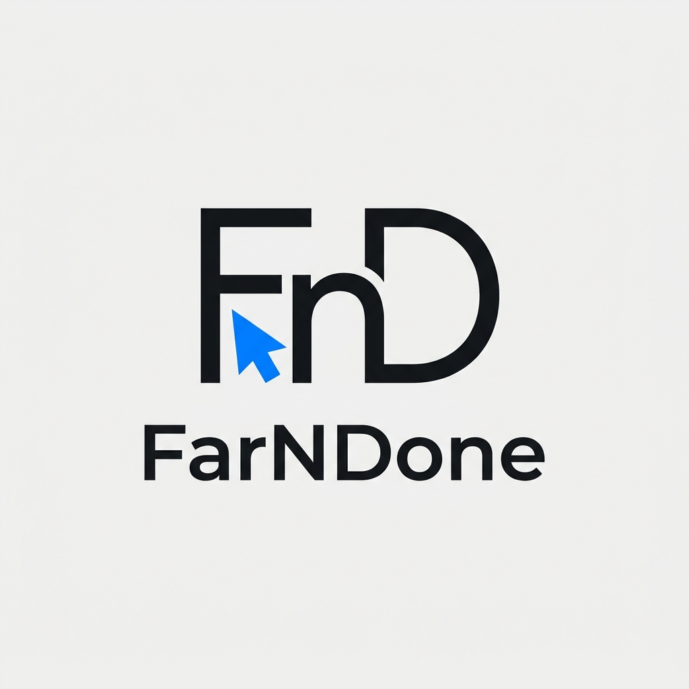

  

<h1 align="center">FarNDone</h1>

  
  
  

FarNDone is a **PC remote-control application** that lets you control and interact with your computer directly from your smartphone. Designed for convenience and simplicity, FarNDone turns your phone into a handy remote for your PC.
